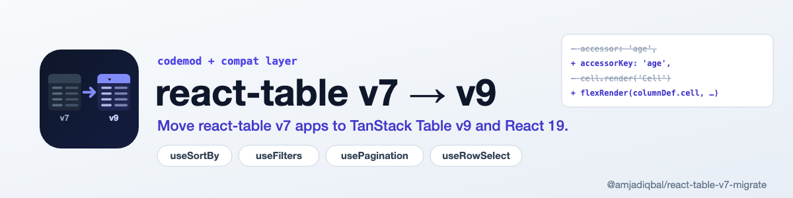

<p align="center">
  <picture>
    <source media="(prefers-color-scheme: dark)" srcset="art/banner-dark.png">
    
  </picture>
</p>

# react-table v7 → TanStack Table v9 codemod (and React 19)

A codemod that rewrites **react-table v7** code (`useTable`, `useSortBy`, `useFilters`, `useGlobalFilter`, `usePagination`, `useRowSelect`, `useExpanded`, `useColumnOrder`, the `getTableProps` / `prepareRow` render loop, and `accessor` / `Header` / `Cell` column definitions) to **TanStack Table v9**. It also ships a few small compat helpers for the parts v9 has no exact equivalent for. Where it cannot migrate something safely, it leaves a `// TODO(react-table-v7-migrate):` comment and lists it in a report.

[](https://www.npmjs.com/package/@amjadiqbal/react-table-v7-migrate)
[](LICENSE.md)

```bash
npx @amjadiqbal/react-table-v7-migrate --dry src
```

## Why

`react-table` 7.8.0 (its last release, May 2022) declares `react ^16.8.3 || ^17 || ^18` as its peer range, so `npm install react@19 react-table@7.8.0` fails with `ERESOLVE` (checked with npm 11.19). TanStack Table, the successor, is now at v9, and its own migration guide starts at v8. This package moves v7 code straight to v9.

This package's tests found two things about v7 on React 19, useful if you need to stay on v7 for a while:

- react-table 7.8.0 does render and work on React 19 once installed with `--legacy-peer-deps` (every app tested below does). In development, though, React 19 logs "A props object containing a "key" prop is being spread into JSX" for every `{...row.getRowProps()}`-style spread.
- v7's `useAsyncDebounce` throws `regeneratorRuntime is not defined` unless your app provides a regenerator runtime global. One of the real apps below imports `regenerator-runtime/runtime` for exactly this reason.

## Usage

1. Commit your work. The codemod rewrites files in place.
2. See what would change:

   ```bash
   npx @amjadiqbal/react-table-v7-migrate --dry src
   ```

3. Run it:

   ```bash
   npx @amjadiqbal/react-table-v7-migrate src
   ```

4. Swap the dependencies:

   ```bash
   npm uninstall react-table @types/react-table
   ```

   ```bash
   npm install @tanstack/react-table@^9
   ```

   If the migrated code imports from `@amjadiqbal/react-table-v7-migrate/compat` (the code and the report show it), also install this package as a dependency:

   ```bash
   npm install @amjadiqbal/react-table-v7-migrate
   ```

5. Work through the `TODO(react-table-v7-migrate)` comments, then format, type-check and test. The codemod does not format: generated code follows the file's quote style but always adds semicolons, so run Prettier or your linter's fixer afterwards.

Run it on the whole source folder in one go. In TypeScript projects, a file that only defines columns is then linked to the table file it imports (see [TypeScript](#typescript)).

### CLI

```text
Usage: react-table-v7-migrate [options] <paths or globs...>

Options:
  --dry        Do not write files; print the report only
  --print      Print each changed file's new code to stdout (implies --dry)
  --json       Print the report as JSON
  -h, --help   Show this help
```

- Directories are searched for `.js`, `.jsx`, `.ts` and `.tsx` files (also `.mjs`, `.cjs`, `.mts`, `.cts`).
- `node_modules`, `dist` and `build` are skipped, and files that don't mention `react-table` are not touched.
- The report lists, per file:
  - whether it changed;
  - how many `useTable` calls were migrated;
  - the v9 features registered;
  - every TODO and note, with its line.
- The exit code is 1 only when a file could not be parsed.

### Programmatic

```ts
import { transformSource } from '@amjadiqbal/react-table-v7-migrate'

const { code, changed, notes, features, tables } = transformSource(source, { filename: 'Table.tsx' })
```

`filename` picks the parser (`.ts`, `.tsx`, `.js` or `.jsx`).

## What it does

Before (the v7 sorting example, shortened):

```jsx
import { useTable, useSortBy } from 'react-table'

function Table({ columns, data }) {
  const { getTableProps, getTableBodyProps, headerGroups, rows, prepareRow } = useTable({ columns, data }, useSortBy)
  return (
    <table {...getTableProps()}>
      <thead>
        {headerGroups.map(headerGroup => (
          <tr {...headerGroup.getHeaderGroupProps()}>
            {headerGroup.headers.map(column => (
              <th {...column.getHeaderProps(column.getSortByToggleProps())}>
                {column.render('Header')}
                <span>{column.isSorted ? (column.isSortedDesc ? ' 🔽' : ' 🔼') : ''}</span>
              </th>
            ))}
          </tr>
        ))}
      </thead>
      <tbody {...getTableBodyProps()}>
        {rows.map(row => {
          prepareRow(row)
          return <tr {...row.getRowProps()}>{row.cells.map(cell => <td {...cell.getCellProps()}>{cell.render('Cell')}</td>)}</tr>
        })}
      </tbody>
    </table>
  )
}

const columns = [{ Header: 'Age', accessor: 'age' }]
```

After (the codemod's output for exactly that code, with blank lines removed):

```jsx
import {
  columnVisibilityFeature,
  createSortedRowModel,
  flexRender,
  rowSortingFeature,
  sortFn_alphanumericCaseSensitive,
  tableFeatures,
  useTable,
} from '@tanstack/react-table';
const features = tableFeatures({
  rowSortingFeature,
  columnVisibilityFeature,
  sortedRowModel: createSortedRowModel(),
  sortFns: {
    alphanumericCaseSensitive: sortFn_alphanumericCaseSensitive
  }
});
// react-table v7's defaults on every column: its case-sensitive alphanumeric sort
const v7DefaultColumn = {
  sortFn: 'alphanumericCaseSensitive'
};
function Table({ columns, data }) {
  const table = useTable({
    features,
    columns,
    data,
    sortDescFirst: false,
    defaultColumn: v7DefaultColumn
  })
  const headerGroups = table.getHeaderGroups();
  const rows = table.getRowModel().rows;
  return (
    <table>
      <thead>
        {headerGroups.map(headerGroup => (
          <tr key={headerGroup.id}>
            {headerGroup.headers.map(header => (
              <th
                key={header.id}
                colSpan={header.colSpan}
                onClick={header.column.getToggleSortingHandler()}
                style={{
                  cursor: header.column.getCanSort() ? 'pointer' : undefined
                }}
                title={header.column.getCanSort() ? 'Toggle SortBy' : undefined}>
                {header.isPlaceholder ? null : flexRender(header.column.columnDef.header, header.getContext())}
                <span>{!!header.column.getIsSorted() ? (header.column.getIsSorted() === 'desc' ? ' 🔽' : ' 🔼') : ''}</span>
              </th>
            ))}
          </tr>
        ))}
      </thead>
      <tbody>
        {rows.map(row => {
          return <tr key={row.id}>{row.getVisibleCells().map(cell => <td key={cell.id}>{flexRender(cell.column.columnDef.cell, cell.getContext())}</td>)}</tr>;
        })}
      </tbody>
    </table>
  );
}
const columns = [{ header: 'Age', accessorKey: 'age' }]
```

### Migrated

**Table setup**

| v7 | v9 |
|---|---|
| `useTable(options, useSortBy, ...)` | `useTable({ features, ...options })`. A module-level `const features = tableFeatures({...})` holds the features, row models and filter/sort functions the plugins need. |
| `useSortBy`, `useFilters`, `useGlobalFilter`, `usePagination`, `useRowSelect`, `useExpanded`, `useColumnOrder` | `rowSortingFeature` + `sortedRowModel`, `columnFilteringFeature` + `filteredRowModel`, `globalFilteringFeature`, `rowPaginationFeature` + `paginatedRowModel`, `rowSelectionFeature`, `rowExpandingFeature` + `expandedRowModel`, `columnOrderingFeature`. `columnVisibilityFeature` is always added: v7's core had column hiding, and v9's `row.getVisibleCells()` needs the feature. |
| `hooks => { hooks.visibleColumns.push(fn) }` (the row-selection checkbox column) | `columns: useMemo(() => fn(columns), [columns])` |
| `const { headerGroups, rows, page, ... } = useTable(...)` | `const table = useTable(...)`, then one `const` per name, e.g. `const page = table.getRowModel().rows`, `const gotoPage = table.setPageIndex`, `const canNextPage = table.getCanNextPage()`. 53 v7 instance names are mapped. |
| `const instance = useTable(...)`, `instance.rows`, `const { ... } = instance` | the same, on the v9 table |
| `state: { pageIndex, sortBy, filters, selectedRowIds, expanded, globalFilter, hiddenColumns, columnOrder }`, `state.x`, `const { x } = state` | reads from `table.state` (`pagination.pageIndex`, `sorting`, `columnFilters`, `rowSelection`, ...) |
| `initialState: { pageIndex, pageSize, sortBy, filters, selectedRowIds, hiddenColumns, ... }` | `initialState: { pagination: { pageIndex, pageSize }, sorting, columnFilters, rowSelection, columnVisibility, ... }` |
| options `manualSortBy`, `manualFilters`, `autoResetPage`, `selectSubRows`, `disableMultiSort`, `disableSortRemove`, `disableSortBy`, `disableFilters`, ... | `manualSorting`, `manualFiltering`, `autoResetPageIndex`, `enableSubRowSelection`, `enableMultiSort: false`, `enableSortingRemoval: false`, ... |
| any other `useTable` option (e.g. `updateMyData`) | moved to `meta`; renderers read it as `table.options.meta?.updateMyData` |

**Rendering**

| v7 | v9 |
|---|---|
| `getTableProps()`, `getTableBodyProps()`, `prepareRow(row)` | removed. An object passed to `getTableProps(...)` stays, as attributes. |
| `{...headerGroup.getHeaderGroupProps()}`, `{...row.getRowProps()}`, `{...cell.getCellProps()}`, `{...column.getHeaderProps()}` | `key={...}` (and `colSpan` for headers) as JSX attributes. Object or array-of-object arguments are merged in like v7's `mergeProps`: later wins, `style` objects merge, and `className` falls back to an earlier attribute. |
| `getSortByToggleProps`, `getToggleRowSelectedProps`, `getToggleAllRowsSelectedProps`, `getToggleAllPageRowsSelectedProps`, `getToggleRowExpandedProps`, `getToggleAllRowsExpandedProps`, `getToggleHiddenProps`, `getToggleHideAllColumnsProps` | the v9 handler and state, with v7's `title` and `cursor: pointer` style, e.g. `onClick={header.column.getToggleSortingHandler()}` |
| `column.render('Header' / 'Footer' / 'Filter')`, `cell.render('Cell' / 'Aggregated')` | `flexRender(<columnDef.header / footer / meta.Filter / cell / aggregatedCell>, x.getContext())` |
| in header loops: `column.isSorted`, `isSortedDesc`, `canSort`, `canFilter`, `filterValue`, `setFilter`, `preFilteredRows`, `isVisible`, `toggleHidden`, ... | `header.column.getIsSorted()`, ... The loop variable is renamed from `column` to `header` when that name is free. |
| rows: `row.cells`, `row.values.x`, `row.values[id]`, `row.isSelected`, `row.isExpanded`, `row.canExpand`, `toggleRowSelected`, `toggleRowExpanded` | `row.getVisibleCells()`, `row.getValue('x')`, `row.getValue(id)`, `row.getIsSelected()`, `row.getIsExpanded()`, `!!row.subRows?.length`, `toggleSelected`, `toggleExpanded` |
| cells: `cell.value` | `cell.getValue()` |

**Column definitions**

| v7 | v9 |
|---|---|
| `accessor: 'a.b'`, `accessor: fn` | `accessorKey: 'a.b'` plus `id: 'a.b'` (v9 would otherwise make the id `a_b`), `accessorFn` |
| `Header`, `Cell`, `Footer`, `Filter` | `header`, `cell`, `footer`, `meta.Filter` |
| `filter`, `sortType`, `sortInverted` | `filterFn`, `sortFn`, `invertSorting` |
| `width` / `minWidth` / `maxWidth` | `size` / `minSize` / `maxSize` |
| `disableSortBy` / `disableFilters` / `disableGlobalFilter` | `enableSorting: false` / `enableColumnFilter: false` / `enableGlobalFilter: false` |
| any other column key (`align`, `className`, ...) | moved to `meta`; `column.align` reads become `column.columnDef.meta?.align` |
| renderer props: `Cell: ({ value, row, column, cell })`, `Header: ({ getToggleAllRowsSelectedProps, rows, state })`, `props.value`, and Filter components `({ column: { filterValue, setFilter, preFilteredRows, id } })` | the v9 context (`getValue`, `row`, `column`, `cell`, `table`), with `const` reads at the top. This covers inline renderers and components defined in the same file. |

**Filters, sorting, helpers and types**

| v7 | v9 |
|---|---|
| built-in filter types `text`, `exactText`, `exactTextCase`, `includesAll`, `includesSome`, `includesValue`, `exact`, `equals`, `between` | `includesString`, `equalsString`, `equalsStringSensitive`, `arrIncludesAll`, `arrIncludesSome`, `arrHas`, `equals`, `weakEquals`, `inNumberRange` |
| built-in sort types `alphanumeric`, `datetime`, `basic`, `string` | `alphanumericCaseSensitive` (v7's alphanumeric is case-sensitive; v9's `alphanumeric` lowercases), `datetime`, `basic`, `text` |
| filter type `includes`, sort type `number` | `filterFn_v7Includes` and `sortFn_v7Number` from `/compat` (v9 has no exact match) |
| custom filter/sort functions (`filter: fn`, `sortType: fn`, `filterTypes`, `sortTypes`) | wrapped with `fromV7FilterType(s)` / `fromV7SortType(s)` from `/compat` |
| `useAsyncDebounce` | `useAsyncDebounce` from `/compat` |
| TypeScript types `Column`, `ColumnInstance`, `TableInstance`, `TableOptions`, `TableState`, `Row`, `Cell`, `HeaderGroup`, `CellProps`, `HeaderProps`, `FilterProps`, `SortingRule`, `Filters`, `IdType` | `ColumnDef<typeof features, D, any>`, `Column<typeof features, D>`, `Table<...>`, `TableOptions<...>`, `TableState<...>`, `Row<...>`, `Cell<...>`, `HeaderGroup<...>`, `CellContext<...>`, `HeaderContext<...>`, `HeaderContext<...>`, `ColumnSort`, `ColumnFiltersState`, `string` |

### v7 behaviour the codemod keeps

v9's defaults differ from v7's in several places. The codemod writes v7's behaviour out explicitly, so the migrated table behaves the same. Delete these lines once you want v9's defaults:

- **`sortDescFirst: false`.** v9 sorts number columns descending first; v7 always started ascending.
- **`v7DefaultColumn.sortFn: 'alphanumericCaseSensitive'`.** v7 sorted every column with its (case-sensitive) alphanumeric sort; v9 picks a sort function per column.
- **`v7DefaultColumn.filterFn` and `globalFilterFn: 'includesString'`.** v7 used its built-in `text` filter for every column and for the global filter. It did this **even when your `filterTypes` overrode `text`**; the override only applied to columns that said `filter: 'text'`.
- **`getSubRows: (row) => row.subRows`.** v7 read `row.subRows` by default; v9 only does with `getSubRows`. It is added when the table uses expanding or row selection, or when the file mentions `subRows`.
- **`getRowCanExpand: () => true`, with `useExpanded`.** v7 let any row expand (that is how "sub component" rows work); v9 only expands rows that have sub rows, unless told otherwise. `row.canExpand` still means "has sub rows".
- **`enableRowRangeSelection: false`, with `useRowSelect`.** v9's row-selection handler selects a range on Shift-click; v7 did not.
- **`selectedFlatRows`** becomes `table.getRowModel().rows.filter((row) => row.getIsSelected())` (the pre-paginated rows with `usePagination`). v7 collected selected rows from the table's current rows, not from collapsed sub rows.

### Differences you may still notice

These are v9 behaviours the codemod does not paper over:

- **Sorting ties.** In a descending sort, v7 put rows with equal values in reverse original order; v9 keeps their original order.
- **Expand all.** v9's `toggleAllRowsExpanded()` stores `expanded: true`; v7 stored every row id. The rows shown are the same.
- **`column.preFilteredRows`** becomes `column.getFacetedRowModel().rows` (the codemod registers `columnFacetingFeature` for it). These are the rows filtered by every other column's filter. v7's list depended on the order the filters were added in, so a filter UI built from it (e.g. a select's options) can list its values in a different order.
- **Auto-reset on data change.** By default, v7 reset sorting, filters, selection and more when `data` changed (`autoResetSortBy`, `autoResetFilters`, `autoResetSelectedRows`, ...). v9 only resets the page index and the expanded state. The codemod drops those options and says so in the report.
- **Empty headers and footers** render nothing; v7 rendered `&nbsp;`. With every column hidden, v9 still returns one (empty) header group.
- **`table.state`'s shape** is v9's (`sorting`, `columnFilters`, `pagination`, `rowSelection`, `columnVisibility`, ...). Code that dumps or stores the whole state object sees different keys.

### Not migrated (left with a TODO)

- `useGroupBy`, grouping and aggregation (`aggregate`, `Aggregated`, `canGroupBy`, `isGrouped`, `isAggregated`, ...). Keys are renamed where v9 has a name for them, but the grouping feature and row model are not set up.
- `useResizeColumns`, `useBlockLayout`, `useFlexLayout`, `useAbsoluteLayout`, `useGridLayout`, `useRowState`, `_UNSTABLE_usePivotColumns`.
- `stateReducer`, `useControlledState`, `orderByFn`, `manualExpandedKey`, `manualRowSelectedKey`, `expandSubRows`, and plugin hook code other than `hooks.visibleColumns.push`.
- `initialState` or the options object passed as a variable instead of an object literal (their keys are not renamed).
- Prop-getter function arguments (`getCellProps((props, meta) => ...)`, or a function passed by name).
- Renderers imported from another file, or wrapped (`React.memo`, `forwardRef`, HOCs). They get a note that they now receive the v9 context, but their props are not rewritten.
- Accessor functions that use v7's third argument (`{ subRows, depth, data }`).
- `import * as RT from 'react-table'`. Switch to named imports and run again.
- Files that augment react-table's types (`declare module 'react-table'`). They are reported and left unchanged; delete them after migrating.
- Code that receives a v7 row, column or table from elsewhere (a prop, a helper's parameter). It is rewritten only where it uses v7-only members the codemod recognises; otherwise you get a note.
- Flow-typed files are not parsed (reported as errors).

## TypeScript

- v7 types become v9 types with the features type first: `Column<User>` → `ColumnDef<typeof features, User, any>`. `TValue` is `any` for column arrays, as TanStack suggests, so typed `Cell` renderers stay assignable.
- `useTable<User>(...)` loses its type argument; v9 infers both generics.
- Parameters of arrow functions the codemod generates get `?: any`, so code compiled with `noImplicitAny` still compiles.
- A file that only defines columns (no `useTable`) needs the table's features type. `ColumnDef<any, User>` is **not** assignable to the table's `ColumnDef<typeof features, User>`, and neither is `ColumnDef<TableFeatures, User>`. So when you run the codemod over a folder holding both files, the CLI links them:
  - the table file exports its `features`;
  - the column file gets `import type { features } from '<the specifier it already uses to import the table>'`;
  - relative imports and tsconfig `baseUrl` / `paths` are followed.

  Otherwise the column file uses `any` and gets a TODO.
- When `filterTypes` / `sortTypes` are defined inside the component, `features` is created there with `useMemo`, and column types fall back to `any`. When they are module-level constants, `features` stays module-level.

## Compat helpers

`@amjadiqbal/react-table-v7-migrate/compat` needs `react` (a peer dependency). It does not load the codemod.

| Export | What it is |
|---|---|
| `useAsyncDebounce(fn, wait?)` | v7's hook. It returns a debounced function; every call made during the wait resolves with the result of the last one. |
| `fromV7FilterType(fn)`, `fromV7FilterTypes(obj)` | Wrap a v7 rows-level filter (`(rows, ids, filterValue) => rows`) as a v9 row-level filter fn. It runs once per row, passing that row as a v7-style row (with `values`), and keeps `autoRemove`. Filters that need all rows at once (ranking, "top N") don't work row by row; rewrite those natively. |
| `fromV7SortType(fn)`, `fromV7SortTypes(obj)` | Wrap a v7 sort type `(rowA, rowB, columnId, desc)`. v9 does not pass `desc` (it is `undefined`); it applies the direction itself, as v7 did. |
| `filterFn_v7Includes` | v7's `includes`: `rowValue.includes(filterValue)` with one filter value (a substring or an array item). v9's `arrIncludes` takes an array of filter values instead. |
| `sortFn_v7Number` | v7's `number` sort: keeps only digits and dots, then compares as numbers. |
| `toV7Row(row)` | A view of a v9 row with v7's `values` object; the wrappers use it. |

## What's tested

All with **react-table 7.8.0**, **@tanstack/react-table 9.3.1** and **React 19.3.1**, on Node 26.7 with npm 11.19.

- **13 of the react-table v7.8.0 example apps** ([TanStack/table v7.8.0 examples](https://github.com/TanStack/table/tree/v7.8.0/examples), MIT): basic, sorting, filtering, pagination, pagination-controlled, row-selection, row-selection-and-pagination, expanding, footers, column-hiding, column-ordering, editable-data, sub-components.
  - The codemod migrates each one. The original (on react-table 7.8.0) and its migrated output (on v9) are then rendered side by side in jsdom on React 19.
  - The same clicks, typing and select changes run on both. After every step, every table cell, checkbox, input and state dump is compared.
  - The only relaxations are the documented differences above: tie order, `expanded: true`, faceted-row order, and whole-state dumps.
  - The examples were changed only to drop styled-components and to use seeded data.
- **The kitchen-sink example** (grouping) and **11 focused cases** are snapshot-tested: the output, the report, and that a second run changes nothing. The cases cover TypeScript types, instance variables, options and initial state, column options, renderer props, prop-getter arguments, state destructuring, module-level filter types, unsupported plugins, a type-augmentation file, and a file that only mentions react-table.
- The TypeScript case's output compiles with `tsc --strict` against @tanstack/react-table 9.3.1.
- **A real app, end to end, in a browser:** [alfianandinugraha/next-tabley](https://github.com/alfianandinugraha/next-tabley) (MIT). It uses Next.js, TypeScript and Chakra UI, with sorting, column filters, a global filter, pagination, row selection, `hooks.visibleColumns` and an `@types/react-table` augmentation.
  - The app's toolchain was upgraded by hand to Next 16.4.2, React 19.3.1 and Chakra UI 2.10.10 (non-table changes only).
  - The codemod changed 3 files and left 1 TODO (delete the type-augmentation file). `tsc --noEmit` passed and `next build` succeeded.
  - In the browser, the migrated page and the untouched v7 page (react-table 7.8.0 on React 19) showed identical tables after each step: sorting ascending and descending, a column filter, the global search, Next, a page-size change, go-to-page, selecting rows, selecting the page and clearing it. There were no console messages.
- **Dry runs only** (the codemod's report; the output was not built or run) on other public MIT apps that use v7:
  - [randyahx/react-webapp](https://github.com/randyahx/react-webapp): 1 file changed, 0 TODOs
  - [uilibrary/uko-react](https://github.com/uilibrary/uko-react): 1 file, 0 TODOs
  - [stevenliuyi/covid19](https://github.com/stevenliuyi/covid19): 1 file, 2 TODOs
  - [Nezteb/github-stars-dashboard](https://github.com/Nezteb/github-stars-dashboard): 1 file, 4 TODOs (resizing and block layout)
  - [ggascoigne/react-table-example](https://github.com/ggascoigne/react-table-example): 12 files, 38 TODOs (it uses grouping, resizing and flex layout throughout)
- **Not tested:** v9 on React 18; the grouping, resizing and layout plugins (not migrated); Flow (not supported).

## Support

- 🐛 **Bug or feature request**: [open an issue](https://github.com/amjadiqbal/react-table-v7-migrate/issues). A v7 snippet the codemod gets wrong is the most useful report.
- 🔒 **Security issue**: please report privately via GitHub's security tab

## Need this built into your app, or something custom?

I migrate and build data-heavy React and TanStack apps: legacy table upgrades, admin tables, server-side filtering, dashboards.
[Get in touch](https://amjad.com.pk/contact?utm_source=github&utm_medium=readme&utm_campaign=react-table-v7-migrate).

[](https://www.upwork.com/freelancers/amjadkhatri)

## More packages

Part of a family of open-source packages. See [all of them](https://github.com/amjadiqbal?tab=repositories).

| | |
|---|---|
| [tanstack-table-url-state](https://github.com/amjadiqbal/tanstack-table-url-state) | URL state and CSV/XLSX export for TanStack Table v9 |
| [tanstack-table-server-query](https://github.com/amjadiqbal/tanstack-table-server-query) | TanStack Table v9 state to Drizzle / Prisma / Kysely / Supabase queries |
| [query-key-kit](https://github.com/amjadiqbal/query-key-kit) | Typed query keys for TanStack Query v5 |
| [start-seo-kit](https://github.com/amjadiqbal/start-seo-kit) | SEO meta, sitemap and robots for TanStack Start |

## Licence

MIT. See [LICENSE.md](LICENSE.md).
